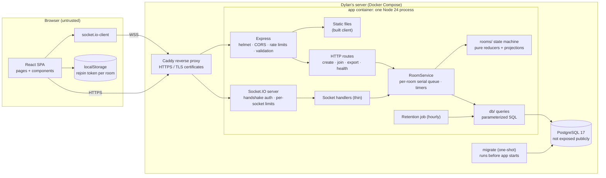
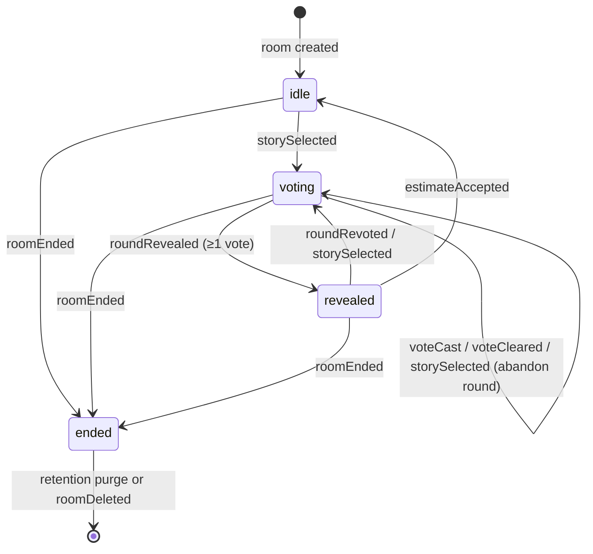
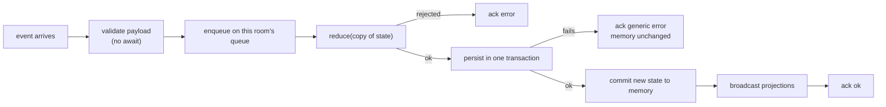
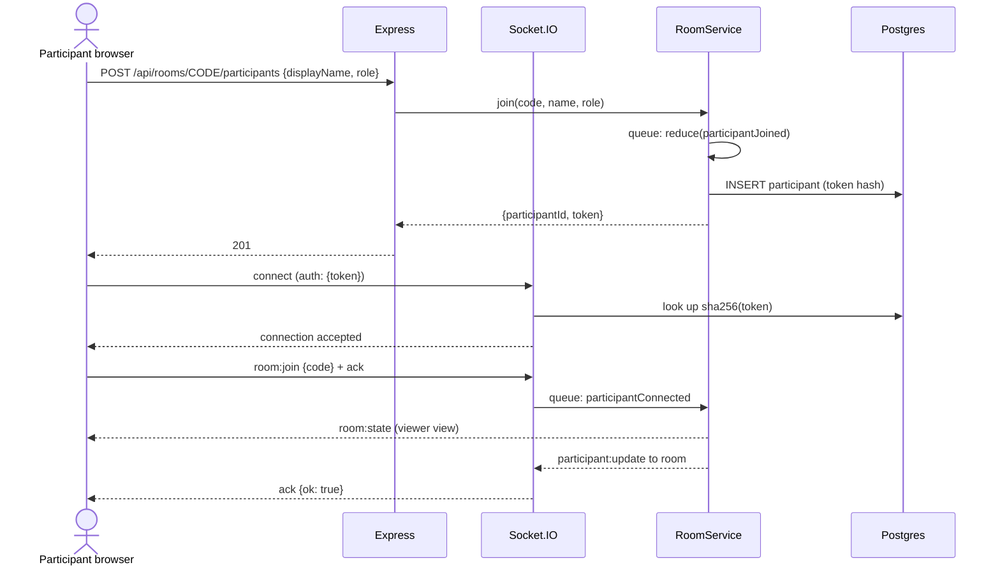
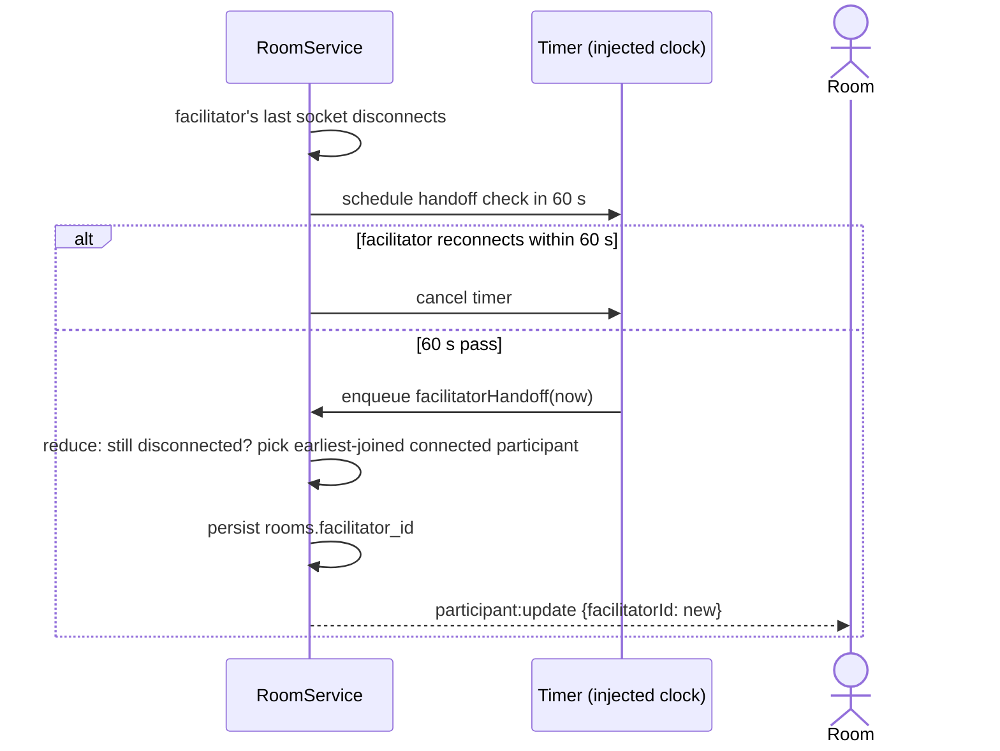

# Architecture

Status: Proposed · Date: 2026-10-22 · Owner: Dylan Ramdath

This document describes how the planning poker app is built: components, data flow, the room state machine, the socket event contract, the database schema, consistency rules, and the UI and accessibility plan. Decisions with real alternatives are recorded as ADRs in [`docs/adr/`](adr/). Security reasoning lives in [`threat-model.md`](threat-model.md), and tests in [`testing-strategy.md`](testing-strategy.md).

This is an independent student project. It is **not affiliated with, endorsed by, or operated by RIT**. It uses an RIT-inspired color palette but no RIT logos, wordmarks, or mascot.

## 1. Requirements summary

| Area     | Decision                                                                                          |
| -------- | ------------------------------------------------------------------------------------------------- |
| Users    | Scrum teams of 4–10 in RIT classes. Up to 50 seats per room, about 30 rooms live at once          |
| Identity | Guests only. A display name plus a random rejoin token in localStorage. No accounts, no RIT login |
| Roles    | Facilitator (votes by default, can switch to observer), voter, observer                           |
| Deck     | Fibonacci only: `0 1 2 3 5 8 13 21 ? ☕`                                                          |
| Stories  | Added one at a time, or pasted as many lines at once                                              |
| Hosting  | Self-hosted by Dylan: one machine running Docker Compose behind an HTTPS reverse proxy            |
| Timeline | MVP used in a real class next semester, about 10–14 weeks at 6–8 hours a week                     |

Non-functional targets:

- A vote appears as "voted" for everyone within 300 ms on campus Wi-Fi.
- A dropped phone connection rejoins the same seat automatically.
- A server restart loses no accepted action.
- WCAG 2.1 AA, from 360 px phones to desktop.

## 2. Component view



Boundaries and responsibilities:

- **Browser.** It is untrusted. It sends intentions and renders what the server says. It never decides game outcomes.
- **Caddy.** It terminates HTTPS, renews certificates automatically, and forwards to the app container. Because of this single proxy hop, Express uses `app.set("trust proxy", 1)`.
- **Express and Socket.IO** run in one process on one origin (ADR-008). They do validation, authentication, and authorization only.
- **RoomService** owns in-memory rooms. It runs each room's events one at a time, persists, then broadcasts.
- **`rooms/` state machine** is pure functions with no I/O. It contains every game rule and is the most heavily tested code.
- **`db/`** holds hand-written, parameterized SQL and the migration runner.
- **Postgres** has no published port and is reachable only on the Compose network.

## 3. Identity, join codes, and tokens

- **Join code.** 8 characters from the 31-symbol alphabet `23456789ABCDEFGHJKMNPQRSTUVWXYZ`, which drops 0, O, 1, I, and L because they are easy to misread on a projector. Each character comes from `crypto.randomInt`. Codes are displayed as `ABCD-EFGH`, and the dash is optional on input. That gives about 8.5 × 10¹¹ possible codes.
- **Rejoin token.** 32 bytes from `crypto.randomBytes`, encoded as base64url. The server returns it once, at create or join time. Postgres stores only `sha256(token)` (ADR-003).
- **Storage.** The client keeps `{ participantId, token }` in localStorage under the key `pp:room:<CODE>`.
- **Transport.** The token travels only in the Socket.IO handshake `auth` field, and in an `Authorization: Bearer` header for CSV export. It never appears in a URL, a cookie, or a log line.

## 4. Room state machine

The state machine lives in `server/src/rooms/` and is pure. Every rule is a function call:

```
reduce(state, action, now) → { ok: true, state, effects } | { ok: false, code }
```

`effects` is a list of things RoomService must do after a successful reduction, such as which broadcasts to send and which timers to start or cancel. The reducer never touches sockets, timers, or the database.

Room `status` is one of `idle`, `voting`, `revealed`, or `ended`.



### 4.1 Transition table

This table is the specification for the state-machine tests, and the tests are written from it first (see testing-strategy §3). "Actor" is checked against server state, never against anything the client claims.

| Action                    | Actor              | Allowed status               | Guards (rejection code)                                                 | Result                                                                                                      |
| ------------------------- | ------------------ | ---------------------------- | ----------------------------------------------------------------------- | ----------------------------------------------------------------------------------------------------------- |
| `participantJoined`       | system (HTTP join) | not `ended`                  | seats < 50 (`ROOM_FULL`); normalized name unique in room (`NAME_TAKEN`) | new seat, `connected: false`                                                                                |
| `participantConnected`    | system             | any                          | participant exists                                                      | `connected: true`, `connectedAt = now`; cancels handoff timer if it is the facilitator                      |
| `participantDisconnected` | system             | any                          | last socket of that participant                                         | `connected: false`, `disconnectedAt = now`; starts 60 s handoff timer if it is the facilitator              |
| `participantLeft`         | self               | any                          | —                                                                       | seat removed, open-round vote removed; if facilitator, immediate handoff                                    |
| `participantRemoved`      | facilitator        | any                          | target exists, target ≠ actor (`INVALID_TARGET`)                        | seat removed, vote removed, target's sockets disconnected                                                   |
| `roleChanged`             | self               | not `ended`                  | role ∈ {voter, observer}                                                | role set; switching to observer removes open-round vote                                                     |
| `storiesAdded`            | facilitator        | not `ended`                  | 1–50 titles per call; room total ≤ 200 (`STORY_LIMIT`)                  | stories appended with `status: pending`                                                                     |
| `storySelected`           | facilitator        | `idle`, `voting`, `revealed` | story exists in room (`NOT_FOUND`)                                      | new round (number = previous + 1 for that story), votes empty, status `voting`; any open round is abandoned |
| `voteCast`                | voter              | `voting`                     | `roundId` = current (`STALE_ROUND`); value ∈ deck (`INVALID_PAYLOAD`)   | own vote set or replaced                                                                                    |
| `voteCleared`             | voter              | `voting`                     | `roundId` = current; has a vote (`NO_VOTE`)                             | own vote removed                                                                                            |
| `roundRevealed`           | facilitator        | `voting`                     | `roundId` = current; ≥ 1 vote (`NO_VOTES`)                              | `revealedAt = now`, status `revealed`                                                                       |
| `roundRevoted`            | facilitator        | `revealed`                   | `roundId` = current                                                     | new round for same story, status `voting`                                                                   |
| `estimateAccepted`        | facilitator        | `revealed`                   | story is current; value is a numeric deck card                          | story `estimated` with `finalEstimate`; `currentStoryId = null`; status `idle`                              |
| `facilitatorTransferred`  | facilitator        | not `ended`                  | target is a current participant                                         | `facilitatorId = target`                                                                                    |
| `facilitatorHandoff`      | system (timer)     | not `ended`                  | facilitator still disconnected and `now − disconnectedAt ≥ 60 s`        | `facilitatorId` = earliest-joined **connected** participant; unchanged if nobody is connected               |
| `roomEnded`               | facilitator        | not `ended`                  | —                                                                       | status `ended`; room becomes read-only                                                                      |

Any action from the wrong actor returns `FORBIDDEN`. Any action in the wrong status returns `INVALID_STATE`. All rejections leave state unchanged.

### 4.2 Projections: the only path to the wire

Two pure functions build every outgoing payload:

- `toPublicView(state)` is used for room broadcasts. Before reveal it includes `hasVoted` per participant and never any vote value.
- `toViewerView(state, participantId)` is used for `room:state` sent to one socket. It is the public view plus `me`, which includes **only the viewer's own** current vote. That is how a rejoining voter gets their seat and vote back.

After reveal, both views include every vote of the revealed round plus `stats`. No handler may serialize room state any other way. The tests scan every emitted packet to enforce this.

### 4.3 Stats on reveal

The stats are computed over numeric votes only. They are count, min, max, mean (one decimal), median, distribution (`{ value: count }`), `consensus` (all numeric votes equal), and counts of `?` and `☕`. The suggested estimate is the median, rounded up to the nearest deck card. The facilitator still chooses.

## 5. Socket event contract

The source of truth will be `shared/events.js`, built in roadmap PR 2.x. This table is its specification.

### 5.1 Rules for every client → server event

1. The handshake must carry a valid token, or the connection is refused. The middleware resolves the token to `socket.data.participantId` and `socket.data.roomId`.
2. The payload must be a plain object with **exactly** the listed keys. Extra keys are rejected (`INVALID_PAYLOAD`).
3. Strings are Unicode-normalized (NFC), trimmed, and have internal whitespace collapsed. They are rejected if they contain control, bidi-override, or zero-width characters.
4. Authorization is checked against server state: the participant is still seated in this room, then the required role, then the status guard.
5. Every event takes a Socket.IO **acknowledgement callback** (a function the client passes as the last argument, which the server calls once with the result). It is called with `{ ok: true }` or `{ ok: false, error: { code, message } }`. Messages are generic and never contain vote values or internal details.
6. Each socket gets a token bucket of 20 events per 10 seconds. Over the limit, the event gets `RATE_LIMITED`. Three violations in a minute disconnect the socket.

### 5.2 Client → server

| Event                  | Payload              | Validation                                                   | Authorization                                                            |
| ---------------------- | -------------------- | ------------------------------------------------------------ | ------------------------------------------------------------------------ |
| `room:join`            | `{ code }`           | 8 chars of the code alphabet, dash optional                  | token's participant belongs to the room with this code; room not deleted |
| `room:leave`           | `{}`                 | —                                                            | seated participant                                                       |
| `story:add`            | `{ titles }`         | array of 1–50 strings; each 1–200 chars after normalization  | facilitator; room total ≤ 200                                            |
| `story:select`         | `{ storyId }`        | UUID                                                         | facilitator                                                              |
| `vote:cast`            | `{ roundId, value }` | UUID; value ∈ `["0","1","2","3","5","8","13","21","?","☕"]` | role `voter`; status `voting`; round current                             |
| `vote:clear`           | `{ roundId }`        | UUID                                                         | role `voter`; status `voting`                                            |
| `round:reveal`         | `{ roundId }`        | UUID                                                         | facilitator; status `voting`                                             |
| `round:revote`         | `{ roundId }`        | UUID                                                         | facilitator; status `revealed`                                           |
| `estimate:accept`      | `{ storyId, value }` | UUID; numeric deck value                                     | facilitator; status `revealed`                                           |
| `participant:remove`   | `{ participantId }`  | UUID                                                         | facilitator; not self                                                    |
| `participant:setRole`  | `{ role }`           | `voter` or `observer`                                        | self                                                                     |
| `facilitator:transfer` | `{ participantId }`  | UUID                                                         | facilitator                                                              |
| `room:end`             | `{}`                 | —                                                            | facilitator                                                              |
| `room:delete`          | `{ code }`           | must equal the room's code (typed confirmation)              | facilitator                                                              |

The last five events are new relative to CLAUDE.md. The proposed CLAUDE.md edit adds them.

### 5.3 Server → client

| Event                | To         | Payload                                                                                                                                                                                                                                                                                                   |
| -------------------- | ---------- | --------------------------------------------------------------------------------------------------------------------------------------------------------------------------------------------------------------------------------------------------------------------------------------------------------- |
| `room:state`         | one socket | `{ room: { code, name, status, facilitatorId, currentStoryId }, me: { participantId, role, isFacilitator, myVote }, participants: [{ id, displayName, role, connected, hasVoted }], stories: [{ id, title, status, finalEstimate, position }], round: { id, number, revealed, votes?, stats? } \| null }` |
| `participant:update` | room       | `{ participants, facilitatorId }`                                                                                                                                                                                                                                                                         |
| `vote:status`        | room       | `{ roundId, votedIds: [participantId] }`                                                                                                                                                                                                                                                                  |
| `round:revealed`     | room       | `{ roundId, votes: [{ participantId, value }], stats }`                                                                                                                                                                                                                                                   |
| `story:update`       | room       | `{ stories, currentStoryId, status, round: { id, number } \| null }`                                                                                                                                                                                                                                      |
| `room:ended`         | room       | `{}`                                                                                                                                                                                                                                                                                                      |
| `room:removed`       | one socket | `{ reason: "kicked" \| "deleted" }`; the server then disconnects the socket                                                                                                                                                                                                                               |
| `error`              | one socket | `{ code, message }`, only for errors with no ack, such as a handshake failure                                                                                                                                                                                                                             |

Transport limits: Socket.IO `maxHttpBufferSize` is 64 KB, enough for 50 titles of 200 characters. A participant may have at most 10 open sockets, one per tab.

## 6. HTTP API

| Route                                | Body / auth                                                    | Success                                    | Limits                                                                      |
| ------------------------------------ | -------------------------------------------------------------- | ------------------------------------------ | --------------------------------------------------------------------------- |
| `POST /api/rooms`                    | `{ roomName ≤ 60, displayName ≤ 40 }`                          | `201 { code, participantId, rejoinToken }` | 5 per 10 min per IP; 503 `CAPACITY` past 200 live rooms                     |
| `POST /api/rooms/:code/participants` | `{ displayName ≤ 40, role }`                                   | `201 { participantId, rejoinToken }`       | 60 per min per IP (sized for a class sharing one IP, see threat model T-09) |
| `GET /api/rooms/:code/export.csv`    | `Authorization: Bearer <token>` of any participant in the room | `200 text/csv` attachment                  | 10 per min per IP                                                           |
| `GET /health`                        | —                                                              | `200 { "status": "ok" }`                   | none                                                                        |

Unknown, ended-and-purged, and deleted codes all return the same `404 { error: "Room not found" }`. JSON bodies are capped at 10 KB. Errors are generic, and stack traces appear only in server logs.

## 7. Database schema

PostgreSQL 17. UUIDs come from the built-in `gen_random_uuid()`. Every size cap is enforced by both the app's validators and a `CHECK` constraint, as defense in depth. Deleting a room cascades to everything it owns.

```sql
CREATE TABLE rooms (
  id               uuid PRIMARY KEY DEFAULT gen_random_uuid(),
  join_code        char(8) NOT NULL UNIQUE
                   CHECK (join_code ~ '^[2-9A-HJKMNP-Z]{8}$'),
  name             text NOT NULL CHECK (char_length(name) BETWEEN 1 AND 60),
  deck_type        text NOT NULL DEFAULT 'fibonacci' CHECK (deck_type IN ('fibonacci')),
  facilitator_id   uuid,
  status           text NOT NULL DEFAULT 'idle'
                   CHECK (status IN ('idle', 'voting', 'revealed', 'ended')),
  current_story_id uuid,
  created_at       timestamptz NOT NULL DEFAULT now(),
  last_activity_at timestamptz NOT NULL DEFAULT now()
);
CREATE INDEX rooms_last_activity_idx ON rooms (last_activity_at);

CREATE TABLE participants (
  id                uuid PRIMARY KEY DEFAULT gen_random_uuid(),
  room_id           uuid NOT NULL REFERENCES rooms (id) ON DELETE CASCADE,
  display_name      text NOT NULL CHECK (char_length(display_name) BETWEEN 1 AND 40),
  role              text NOT NULL CHECK (role IN ('voter', 'observer')),
  rejoin_token_hash bytea NOT NULL UNIQUE CHECK (octet_length(rejoin_token_hash) = 32),
  joined_at         timestamptz NOT NULL DEFAULT now(),
  last_seen         timestamptz NOT NULL DEFAULT now()
);
CREATE UNIQUE INDEX participants_room_name_uq ON participants (room_id, lower(display_name));

ALTER TABLE rooms
  ADD CONSTRAINT rooms_facilitator_fk FOREIGN KEY (facilitator_id)
  REFERENCES participants (id) ON DELETE SET NULL DEFERRABLE INITIALLY DEFERRED;

CREATE TABLE stories (
  id             uuid PRIMARY KEY DEFAULT gen_random_uuid(),
  room_id        uuid NOT NULL REFERENCES rooms (id) ON DELETE CASCADE,
  title          text NOT NULL CHECK (char_length(title) BETWEEN 1 AND 200),
  position       integer NOT NULL CHECK (position >= 0),
  status         text NOT NULL DEFAULT 'pending' CHECK (status IN ('pending', 'estimated')),
  final_estimate text CHECK (final_estimate IN ('0','1','2','3','5','8','13','21')),
  created_at     timestamptz NOT NULL DEFAULT now(),
  UNIQUE (room_id, position),
  CHECK ((status = 'estimated') = (final_estimate IS NOT NULL))
);

ALTER TABLE rooms
  ADD CONSTRAINT rooms_current_story_fk FOREIGN KEY (current_story_id)
  REFERENCES stories (id) ON DELETE SET NULL DEFERRABLE INITIALLY DEFERRED;

CREATE TABLE rounds (
  id           uuid PRIMARY KEY DEFAULT gen_random_uuid(),
  story_id     uuid NOT NULL REFERENCES stories (id) ON DELETE CASCADE,
  round_number integer NOT NULL CHECK (round_number >= 1),
  started_at   timestamptz NOT NULL DEFAULT now(),
  revealed_at  timestamptz,
  UNIQUE (story_id, round_number)
);

CREATE TABLE votes (
  round_id       uuid NOT NULL REFERENCES rounds (id) ON DELETE CASCADE,
  participant_id uuid NOT NULL REFERENCES participants (id) ON DELETE CASCADE,
  value          text NOT NULL CHECK (value IN ('0','1','2','3','5','8','13','21','?','☕')),
  cast_at        timestamptz NOT NULL DEFAULT now(),
  PRIMARY KEY (round_id, participant_id)
);
CREATE INDEX votes_participant_idx ON votes (participant_id);
```

The foreign keys between `rooms` and `participants`/`stories` are circular, so they are `DEFERRABLE INITIALLY DEFERRED`. That means Postgres checks them at commit, which lets "create room and its facilitator" happen in one transaction.

Differences from the CLAUDE.md data model are listed in the proposed CLAUDE.md diff. They are `status` values, `current_story_id`, `last_activity_at`, `joined_at`, `started_at`, `cast_at`, and no `stories.description` until a feature uses it.

**Database roles.** `pp_migrator` owns the schema and is used only by the migrate service. `pp_app` gets `SELECT, INSERT, UPDATE, DELETE` on the tables and nothing else: no `CREATE`, no `DROP`, no superuser.

## 8. Consistency between memory and Postgres

### 8.1 Per-room serial queue (ADR-009)

Node runs JavaScript on one thread. It can still interleave two handlers whenever one of them `await`s the database. RoomService prevents that by running each room's events strictly one at a time:



Consequences:

- **Two reveal clicks.** The first moves the room to `revealed`. The second fails the `roundId`/status guard. Exactly one `round:revealed` is broadcast.
- **A vote racing a reveal.** If the vote is queued first, it is persisted and included in the reveal. If the reveal is first, the vote is rejected with `INVALID_STATE`. A vote is never acknowledged and then missing.
- **A failed write** is never visible to anyone, because memory changes only after the database commit.

### 8.2 Lifecycle of in-memory rooms

- **Hydrate lazily.** The first socket for a room loads it from Postgres: participants, stories, the current round, and its votes.
- **Unload** after 10 minutes with no connected sockets. Postgres already has everything.
- **`last_activity_at`** is updated in the same transaction as every persisted event.

### 8.3 Restart and redeploy

A redeploy is `docker compose up -d --build`. Compose sends SIGTERM to the old container, waits up to `stop_grace_period` (set to 15 s), then starts the new one. Only one instance ever runs, so two servers can never hold the same room.

On SIGTERM the server:

1. stops accepting new HTTP and socket connections;
2. waits for every room queue to drain, since each in-flight event is already being persisted;
3. closes Socket.IO, which disconnects clients so they start reconnecting;
4. calls `pool.end()` and exits with code 0.

Clients see the reconnecting banner for a few seconds. They then rejoin with their tokens and receive a fresh `room:state` hydrated from Postgres. No accepted action is lost, because nothing is acknowledged before it is committed.

The handoff timer is not persisted. After a restart, every participant starts disconnected and reconnects. A facilitator who does not return within 60 seconds of the room being hydrated is handed off then.

## 9. Retention and backups

- **Inactive rooms.** An hourly in-process job runs `DELETE FROM rooms WHERE last_activity_at < now() - interval '30 days'`. The cascade removes everything else. Matching rooms are also evicted from memory.
- **Delete now.** The facilitator can delete a room immediately with `room:delete`.
- **Backups.** A nightly `pg_dump` keeps a rolling 7 days. Deleted data can therefore persist in backups for up to 7 more days. The privacy page states a maximum of 37 days.

## 10. Sequence diagrams

### 10.1 Create a room

```mermaid
sequenceDiagram
  actor F as Facilitator browser
  participant API as Express
  participant S as RoomService
  participant DB as Postgres
  F->>API: POST /api/rooms {roomName, displayName}
  API->>API: rate limit, validate body
  API->>S: createRoom(name, displayName)
  S->>S: code = randomCode(), token = randomBytes(32)
  S->>DB: BEGIN; INSERT room + facilitator (token hash); COMMIT
  alt code collision (unique violation)
    S->>S: retry with a new code (max 3)
  end
  S-->>API: {code, participantId, token}
  API-->>F: 201 {code, participantId, rejoinToken}
  F->>F: localStorage["pp:room:CODE"] = {participantId, token}
  F->>F: navigate to /room/CODE (then join flow 10.2, socket part)
```

### 10.2 Join



### 10.3 Cast a vote

```mermaid
sequenceDiagram
  actor V as Voter
  participant IO as Socket handler
  participant S as RoomService
  participant DB as Postgres
  actor R as Everyone in room
  V->>IO: vote:cast {roundId, value} + ack
  IO->>IO: validate shape, rate limit
  IO->>S: enqueue voteCast
  S->>S: reduce: voter? voting? current round? value in deck?
  S->>DB: UPSERT vote; UPDATE rooms.last_activity_at
  S->>S: commit state
  S-->>R: vote:status {roundId, votedIds} (no values)
  S-->>V: ack {ok: true}
```

### 10.4 Reveal

```mermaid
sequenceDiagram
  actor F as Facilitator
  participant S as RoomService
  participant DB as Postgres
  actor R as Everyone in room
  F->>S: round:reveal {roundId}
  S->>S: reduce: facilitator? voting? roundId current? ≥1 vote?
  S->>DB: UPDATE rounds SET revealed_at; UPDATE rooms status
  S->>S: commit; compute stats
  S-->>R: round:revealed {votes, stats}
  S-->>F: ack {ok: true}
  F->>S: round:reveal {roundId} (double click)
  S-->>F: ack {ok: false, code: INVALID_STATE}
```

### 10.5 Reconnect after a dropped connection

```mermaid
sequenceDiagram
  actor P as Participant phone
  participant IO as Socket.IO
  participant S as RoomService
  actor R as Room
  P--xIO: screen locks, socket drops
  IO->>S: participantDisconnected
  S-->>R: participant:update (connected: false)
  Note over P: phone wakes; socket.io-client retries with backoff
  P->>IO: connect (auth: {token from localStorage})
  P->>IO: room:join {code}
  IO->>S: participantConnected (same participantId)
  S-->>P: room:state (includes myVote)
  S-->>R: participant:update (connected: true)
```

### 10.6 Facilitator handoff



## 11. UI and accessibility plan

### 11.1 Screen inventory

Every screen defines all four states: loading, empty, error, and disconnected.

| Screen                      | Route                    | Contents                                                                                                                                | Empty / error / disconnected                                                                                                                 |
| --------------------------- | ------------------------ | --------------------------------------------------------------------------------------------------------------------------------------- | -------------------------------------------------------------------------------------------------------------------------------------------- |
| Landing                     | `/`                      | "Create a room" and "Join a room" (code field); short description; footer with privacy link and "Not affiliated with RIT"               | Error banner if the API is unreachable                                                                                                       |
| Create room                 | `/new`                   | Room name, your display name, submit                                                                                                    | Inline field errors (`aria-describedby`); 429/503 message                                                                                    |
| Join                        | `/join/:code?`           | Code (prefilled from link), display name, "Join as observer" checkbox                                                                   | "Room not found", "Name taken", "Room full"                                                                                                  |
| Voting room                 | `/room/:code`            | Header (room name, code + copy-link button), current story, card deck, who-has-voted list, facilitator bar (Reveal, Revote, Next story) | No story selected: facilitator sees "Add or pick a story", others see "Waiting for the facilitator". Disconnected: banner, controls disabled |
| Backlog panel               | inside room              | Story list with status and estimate; add field and paste-many textarea (facilitator)                                                    | Empty: "No stories yet"                                                                                                                      |
| Revealed                    | inside room              | Cards face-up beside names, stats (average, median, range, consensus), facilitator picks the estimate (median preselected) and accepts  | —                                                                                                                                            |
| Summary                     | `/room/:code` when ended | Estimated stories table, CSV export (facilitator), delete room                                                                          | —                                                                                                                                            |
| Not found / removed / ended | `/room/:code`            | Plain explanation and a link home                                                                                                       | —                                                                                                                                            |
| Privacy                     | `/privacy`               | What is collected, why, retention (30 days + up to 7 days of backups), no tracking, contact                                             | —                                                                                                                                            |

The voting screen shows only the story, the cards, who has voted, and facilitator controls. The backlog is a collapsible panel: a side column on desktop, a disclosure button on phones.

### 11.2 Branding

The palette is **RIT-inspired**: orange `#F76902`, black, and white, with neutral grays. The app does **not** use RIT logos, the wordmark, the tiger, or seals, which RIT reserves for official use. The footer, README, and privacy page say "Independent student project, not affiliated with or endorsed by RIT." Bright RIT orange is only 3.0:1 against white, so it is used as a **fill behind dark text**. A darker orange carries text, focus rings, and borders.

### 11.3 Design tokens (`client/src/styles/tokens.css`)

All ratios below were computed with the WCAG 2.1 relative-luminance formula. Requirements are 4.5:1 for text and 3:1 for UI component boundaries.

| Token                                                         | Light     | Ratio                     | Dark      | Ratio                    |
| ------------------------------------------------------------- | --------- | ------------------------- | --------- | ------------------------ |
| `--color-bg`                                                  | `#FFFFFF` | —                         | `#0F1115` | —                        |
| `--color-surface`                                             | `#F4F5F7` | —                         | `#181B21` | —                        |
| `--color-surface-raised`                                      | `#FFFFFF` | —                         | `#20242C` | —                        |
| `--color-text`                                                | `#1A1D23` | 16.9 on bg                | `#E8EAED` | 15.7 on bg               |
| `--color-text-muted`                                          | `#4B5563` | 6.9 on surface            | `#A3A9B5` | 6.6 on raised            |
| `--color-accent-fill` (primary buttons, selected-card header) | `#F76902` | —                         | `#F76902` | —                        |
| `--color-on-accent`                                           | `#1A1D23` | 5.6 on fill               | `#0F1115` | 6.3 on fill              |
| `--color-accent-text` (links, focus ring, selected border)    | `#A84300` | 6.1 on bg, 5.5 on surface | `#FF8A3D` | 8.1 on bg, 6.6 on raised |
| `--color-selected-bg`                                         | `#FFE7D6` | text 14.2; border 5.1     | `#3A2414` | text 12.1                |
| `--color-success`                                             | `#15803D` | 5.0                       | `#4ADE80` | 10.8                     |
| `--color-danger`                                              | `#B91C1C` | 6.5                       | `#F87171` | 6.8                      |
| `--color-warning`                                             | `#A15C07` | 5.2                       | `#FBBF24` | 11.3                     |
| `--color-border-strong` (inputs, cards)                       | `#6B7280` | 4.8                       | `#8A919E` | 6.0                      |
| `--color-border-subtle` (decorative dividers only)            | `#E5E7EB` | n/a                       | `#2A2F38` | n/a                      |

The bright orange alone is never a meaningful boundary on light surfaces, where it is only 2.8:1. Selected cards use a thicker `--color-accent-text` border, the selected background, and a ✓ mark (screen readers hear "pressed" via `aria-pressed`). The word "Selected" was dropped because it overflowed the card at phone widths.

| Group   | Tokens                                                                                                                                                                                                                           |
| ------- | -------------------------------------------------------------------------------------------------------------------------------------------------------------------------------------------------------------------------------- |
| Type    | `--font-sans: system-ui, -apple-system, "Segoe UI", Roboto, sans-serif`; sizes 0.75 / 0.875 / 1 / 1.25 / 1.5 / 2 / 2.5 rem (ratio ≈ 1.25); weights 400 / 600 / 700; line height 1.5 body, 1.2 headings                           |
| Spacing | 4 px base: `--space-1` 0.25rem … `--space-8` 4rem (4, 8, 12, 16, 24, 32, 48, 64 px)                                                                                                                                              |
| Radius  | `--radius-sm` 4px, `--radius-md` 8px, `--radius-lg` 12px, `--radius-pill` 999px                                                                                                                                                  |
| Shadow  | `--shadow-1/2/3` for raised, card, and dialog. Dark mode uses lower-opacity shadows plus a `--color-border-subtle` outline                                                                                                       |
| Motion  | `--duration-fast` 120ms, `--duration-base` 200ms, `--duration-flip` 400ms, `--ease-standard` `cubic-bezier(.2,0,0,1)`; under `prefers-reduced-motion: reduce` all durations become 0ms and the card flip becomes an instant swap |
| Focus   | `--focus-ring: 3px solid var(--color-accent-text)` with 2px offset, on `:focus-visible`                                                                                                                                          |
| Touch   | `--target-min: 44px`                                                                                                                                                                                                             |

Theme follows `prefers-color-scheme`.

### 11.4 Card deck keyboard model

The deck is a `<div role="group" aria-labelledby="deck-label">` of native `<button aria-pressed>` elements with a **roving tabindex**: only one card is in the Tab order at a time, and arrow keys move between cards.

| Key             | Effect                                                                       |
| --------------- | ---------------------------------------------------------------------------- |
| Tab / Shift+Tab | Enter or leave the deck; focus lands on the selected card, or the first card |
| ← → ↑ ↓         | Move focus to previous or next card, wrapping                                |
| Home / End      | First / last card                                                            |
| Enter / Space   | Cast this card; on the already-selected card, clear the vote                 |

Native radio buttons were rejected because arrow keys on radios change the selection, which would cast a vote on every arrow press.

Screen readers announce each card as, for example, "5 points, toggle button, pressed". The `?` card has the accessible name "Unsure" and `☕` has "Need a break". Cards are at least 44 × 44 px. At 360 px the deck wraps to two rows of five.

### 11.5 Announcements

| Event                      | Region                                  | Text                                                   |
| -------------------------- | --------------------------------------- | ------------------------------------------------------ |
| Vote progress              | `role="status"` (polite), debounced 1 s | "3 of 5 voters have voted"                             |
| Own vote                   | same                                    | "You voted 5" / "Vote cleared"                         |
| Reveal                     | same                                    | "Votes revealed. Average 5.3, median 5, range 3 to 8." |
| Facilitator change         | same                                    | "Alex is now the facilitator"                          |
| Connection lost / restored | `role="alert"`                          | "Connection lost. Reconnecting…" / "Reconnected"       |

The who-has-voted list shows a check icon (`aria-hidden`) **and** the text "Voted" or "Waiting", so status never relies on color. Headings run in order: h1 room name, h2 current story, h2 participants.
